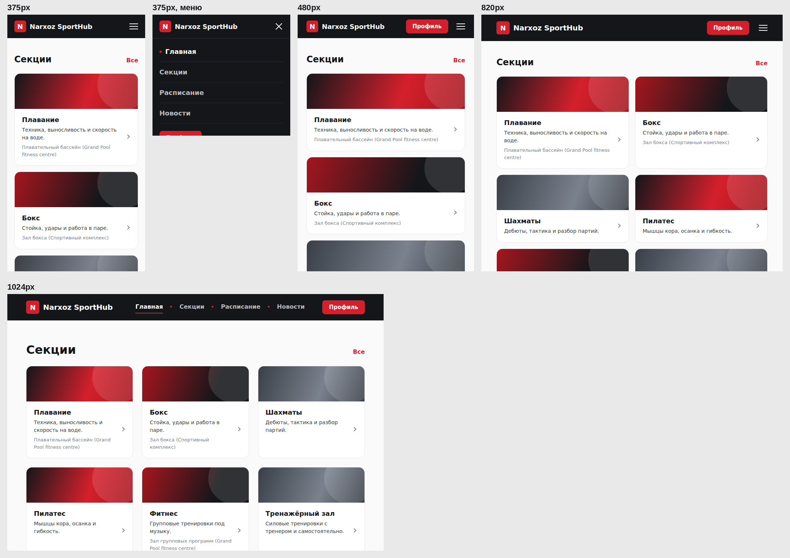
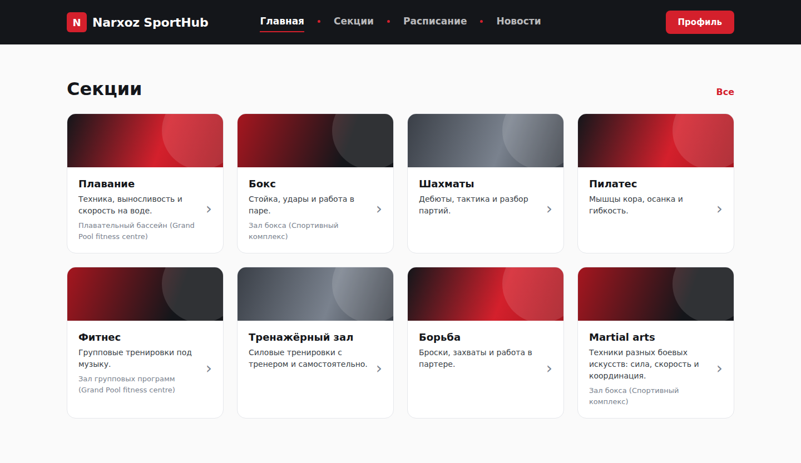

# Narxoz SportHub - student sports portal (coursework)

**Live demo:** https://dinistina.github.io/narxoz-student-portal/

A concept website for a university's student sports clubs: browse sports
sections, check the training schedule, read sports news, and view a student
profile with active bookings. Static HTML/CSS, responsive from 375 px phones to
1440 px desktops.

> Team coursework project for a web development course at Narxoz University.
> **Not an official Narxoz University website** - all contacts and the student
> profile are demo data.

## My contribution

I built the **home page** - `index.html` and `css/main.css`: the hero section
with calls to action and the grid of sports-section cards linking into the
Sections page. The other pages (Sections, Schedule, News, Profile) and the shared
layout were built by teammates.

## Pages

| Page | What it shows |
|---|---|
| `index.html` | Hero + grid of sports sections |
| `sections.html` | All sections with photos, filters by category, sign-up buttons |
| `schedule.html` | Weekday / weekend training timetable |
| `news.html` | News, events, results and honour board |
| `profile.html` | Demo student card, info panel and current bookings |

## Tech

- Semantic HTML5 (`header`, `nav`, `main`, `article`, `footer`, `aria-current`)
- CSS3: Flexbox and Grid layouts, media-query breakpoints, CSS custom styling per page
- Google Fonts (Onest), lazy-loaded images
- No JavaScript, no build step - open `index.html` in a browser

## Responsive layout

## Run locally

Clone the repo and open `index.html` in any browser.
